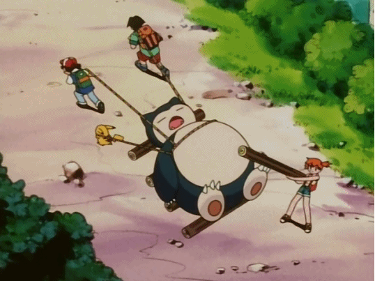

# Mohamed Nafti

  

 

 

  Tunis, Tunisia &nbsp;·&nbsp; Computer Science Student

  
  &nbsp;&nbsp;
  
  &nbsp;&nbsp;
  

### root@ennnaftchi:~# 你好 📬

Computer Science student @ ISI, UTM, Tunisia. Focused on Security Engineering, DevSecOps, and Systems Automation.

Currently learning through hands-on projects, technical experimentation, open-source exploration, R&D, and CTFs.

**CTF Handle:** `@Ennnaftchi`

 

 
